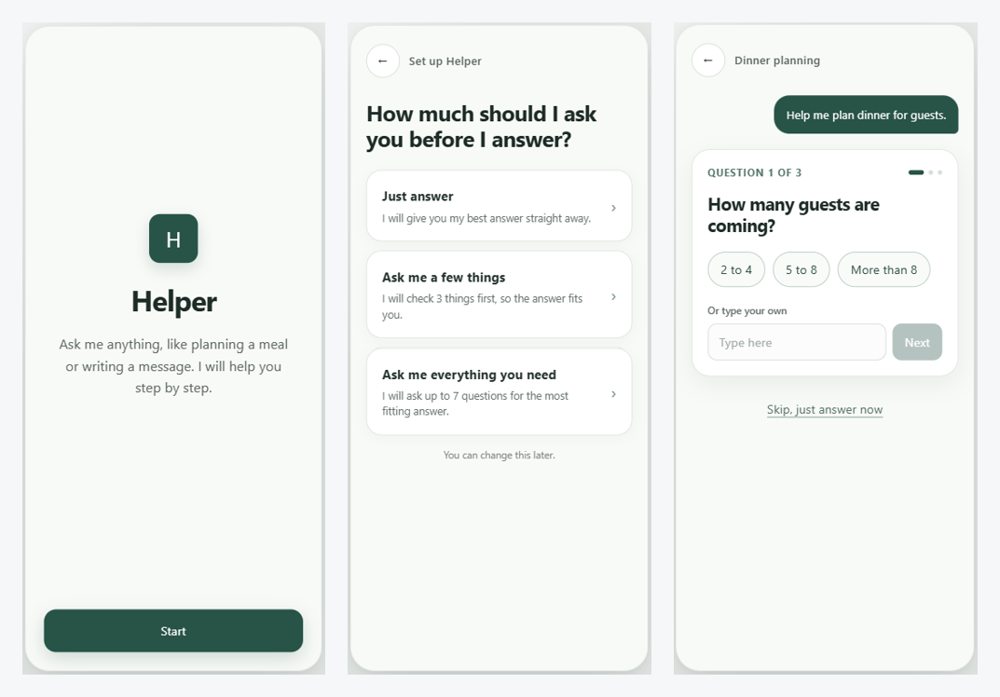
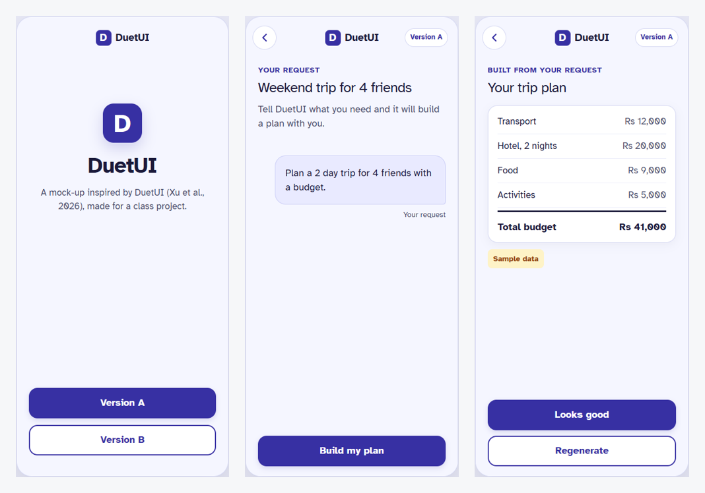
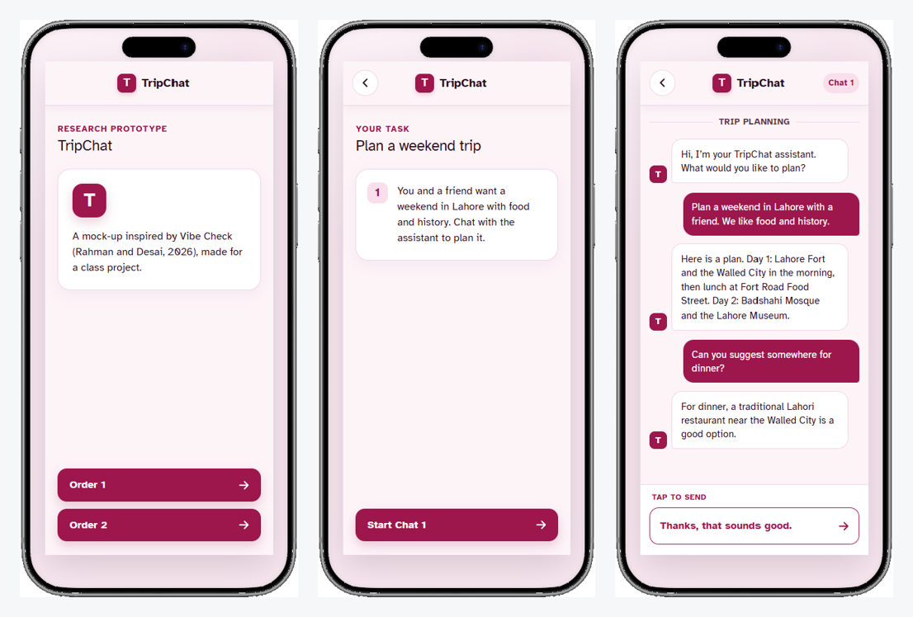
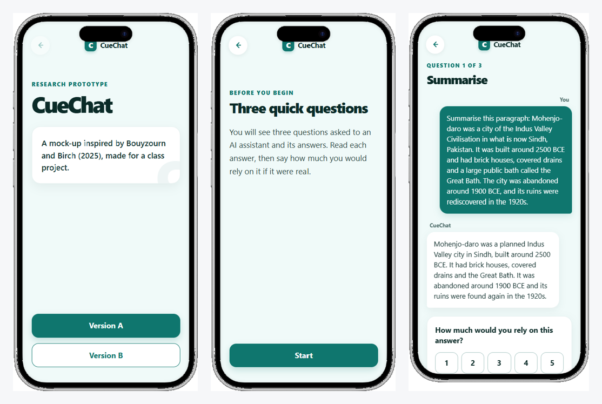
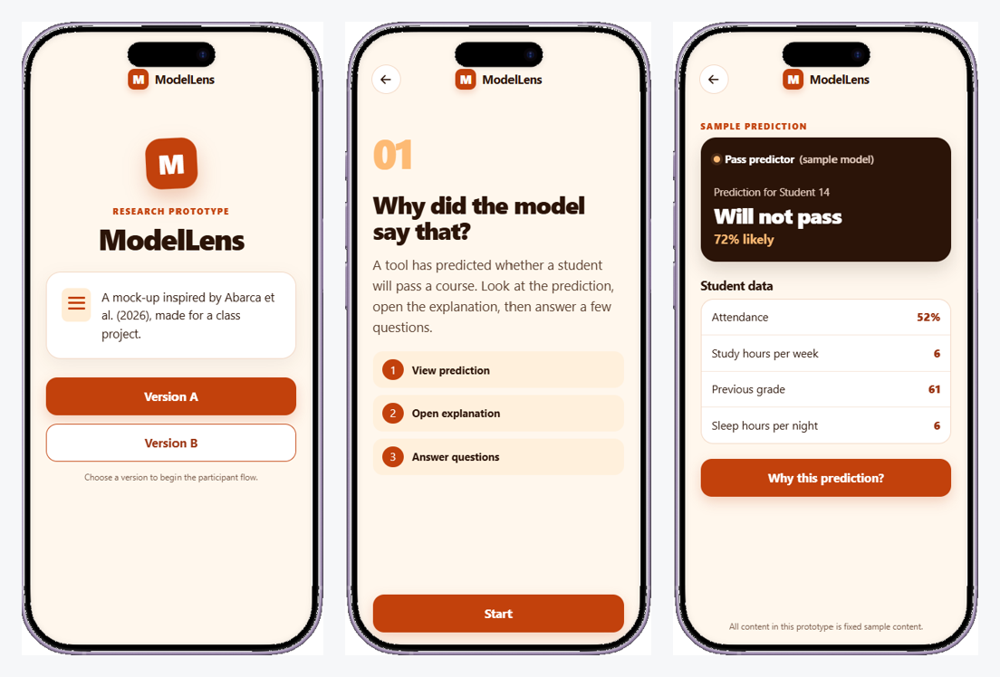

# Human-AI Interaction: Five Prototype Studies

Research project for Applied Human-Computer Interaction (CS 3014) at FAST NUCES Karachi, 2026.

For each of five recent HCI papers on AI interfaces, I reviewed the paper and related work, found a gap the authors left open, designed a clickable prototype in Figma Make to test it, and ran a small user study. Each study is written up as a short IEEE-format paper.

**Full report:** [AHCI_Project_Report.pdf](AHCI_Project_Report.pdf)

> Each study had three or four participants, so the results are exploratory. They point to design questions worth testing at a larger scale and are not general conclusions.

---

## 1. Helper: letting novice users control clarifying questions

**Based on:** Huang et al., *How Does Conversation Length Impact User's Satisfaction?* (CHI EA '24)

**Gap:** The evidence on how many clarifying questions users want comes from young, experienced chatbot users, and the number was set by the researchers.

**Question:** How do users with little chatbot experience respond when they choose the number of questions themselves?

**Prototype:** A mobile chatbot where the user picks no questions, three questions or a longer set, and can skip or change the choice.

**Findings:** The main problems had nothing to do with the number of questions. Two participants mistook the answer for a summary, two missed the control for changing the setting, and one could not read the small text. The prototype was revised to fix these.

[Open prototype](https://www.figma.com/make/P82UNGYltGn1VXMPn0rZY2/Clickable-mobile-app-prototype?t=nyYoQdkQq3MwF30L-1)

---

## 2. Recovering trust after an AI agent makes an error

**Based on:** Xu et al., *DuetUI* (2026)

**Gap:** The DuetUI authors found trust to be the main concern and proposed source verification and error repair, but did not test them.

**Question:** Do source links and a verify-and-repair step help users recover trust after the agent makes a mistake?

**Prototype:** A trip-planning interface in two versions, each with a planted arithmetic error in the budget. Version A only allows accepting or regenerating. Version B adds source links, a source check that flags the mismatch, a fix button and an action history.

**Findings:** Only one of four participants noticed the error without help. The one participant who used the verification features rated trust higher afterwards. All four asked for a clearer basis for the plan.

[Open prototype](https://www.figma.com/make/0KqkXt0CMqMKOMIqpH2D7s/Clickable-Mobile-App-Prototype?t=HTh2wu18zPM8HJhN-1)

---

## 3. TripChat: changing only the extraversion of a chat assistant

**Based on:** Rahman and Desai, *Vibe Check* (CHI '26)

**Gap:** Vibe Check changed all five Big Five traits together, so the effect of any single trait could not be isolated.

**Question:** Does changing only extraversion, with other traits held constant, change how likeable and trustworthy users find the assistant?

**Prototype:** Two scripted trip-planning assistants that give identical content and differ only in tone, one calm and reserved, one lively and outgoing. Order was varied across participants.

**Findings:** The lively assistant was rated higher on likeability (mean 4.0 vs 3.0) and slightly higher on trust, and two of three participants preferred it. Two participants said the plan mattered more than the tone.

[Open prototype](https://www.figma.com/make/98crNsjdKUEtm3vmZtOilf/TripChat-mobile-app-prototype?t=tA6MjRgYpyYlBKBr-1)

---

## 4. CueChat: task-specific reliability cues for chat answers

**Based on:** Bouyzourn and Birch, *What Shapes User Trust in ChatGPT?* (2025)

**Gap:** The authors found trust was lowest for sources and called for explicit accuracy cues, without testing an interface.

**Question:** Do reliability cues for each type of answer help users match their reliance to how reliable the answer actually is?

**Prototype:** A chat interface in two versions. Version B adds a card under each answer stating how reliable that kind of answer usually is (high for a summary, low for references), with a tip on how to check it.

**Findings:** With the cues, the invented references got the lowest reliance rating and were the only answer chosen for double-checking. Without the cues, the same references were rated 4 out of 5 and not checked.

[Open prototype](https://www.figma.com/make/vFi5GaXWpotxvDlUhlf9Mk/Clickable-Mobile-App-Prototype?t=iB5rTjGerCcI6Nwj-1)

---

## 5. ModelLens: layered explanations for ML predictions

**Based on:** Abarca et al., *Explaining AI Without Code* (LatinX in AI, NeurIPS 2025)

**Gap:** Novices and experts judged the same explanations differently. The authors recommend adaptive explanations but did not test them.

**Question:** Does an explanation that starts simple and opens more detail on request satisfy both novices and experts?

**Prototype:** A sample model predicts whether a student will pass. Version A shows one fixed technical explanation. Version B shows the same content in three layers, from a plain-language summary to technical detail.

**Findings:** All three participants identified the most important factor correctly. The Version B participant rated understanding and ease highest but still trusted the prediction little. Two participants commented on what the model leaves out rather than on the explanation itself.

[Open prototype](https://www.figma.com/make/mQU8PHo18sFpktwecHWwi2/Clickable-mobile-app-prototype?t=fMPve6T2jK63Nqx4-1)

---

## Methods

All prototypes were built in Figma Make and use fixed sample content; no live language model is connected. Participants used the prototypes one at a time with the researcher present, then gave ratings and short comments. The researcher recorded which controls each participant used and noticed. No identifying participant information is included in this repository.

## Note on AI use

Generative AI tools were used for drafting support and language editing. The study design, sessions and analysis are my own.

## Author

Wardah Ahmed, BS Computer Science, FAST NUCES Karachi
